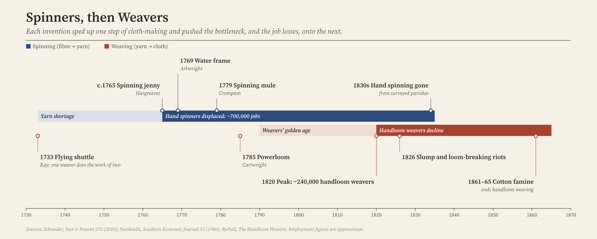

When I first started working with big data sets in the 2010s, the analogy being thrown around was that data mining was like digging for oil. Around that time large organizations (and biological scientists using cheap next-generation sequencing) had figured out that having immense amounts of data was valuable, but they needed someone to turn that raw data into value, competitive advantage, insights, or answers to questions, etc.

What this analogy misses is that there are two distinct steps to the production pipeline going from crude oil (data) to the fully refined product (insights). I thought it might be better served by another analogy paired with a historical example, one that can provide clues for predicting the shape of data work in this new age of AI.

## The spinners and the weavers of the industrial revolution

For those who aren't all that crafty (like myself), here's a history lesson and some background on how you make cloth. The British textile industry of the 1700s involved the prototypical "cottage industry," with a workforce made up mostly of women serving in two different roles along the path from raw cotton to finished cloth. First, the cotton fibers had to be spun into yarn. This was done by the spinners, who for centuries were women who worked from home in their spare time. This yarn was the raw material, the thread, that then could be used by hand weavers on a loom to create full pieces of cloth. It's the weavers who are most often cited in technological automation stories told by historians, as their roles were automated out of existence by the powerlooms of large factories, but the replacement of the spinners actually occurred first. It was just not studied, because it primarily affected women.

## Okay, cool history, but what does this all have to do with data?

Spinning is a lot like the quality control, upstream processing, and basic data cleaning that has to happen at the start of any data project. It results in the processed data products that can be used, woven if you will, into helpful insights. Around the 18th and 19th centuries both the spinners and the weavers endured a period of intense technological change. New technologies fundamentally changed or disrupted their profession, much like the effects being experienced right now by those working with data, coding, and AI.

From 1765 to 1779, three new technological inventions (the spinning jenny, the water frame, and the spinning mule) made spinning dramatically more efficient and automated. This did two things: 1) over the next few decades the number of cottage spinners declined rapidly,[^spinners] putting hand spinners out of work almost entirely by the 1830s, and 2) it led to a massive amount of cheap yarn available for weaving. This, in turn, created a brief "golden age" for the hand weavers, with their numbers peaking in 1820 before the powerloom ultimately put them all out of work by the 1860s.

[^spinners]: Benjamin Schneider, ["A historical episode of job-destroying technology: technological unemployment in the British Industrial Revolution"](https://pastandpresent.org.uk/a-historical-episode-of-job-destroying-technology-technological-unemployment-in-the-british-industrial-revolution/), *Past & Present*.

{fig-alt="Timeline from 1730 to 1870 showing spinning inventions in the 1760s and 1770s displacing roughly 700,000 hand spinners by the 1830s, while hand weaving enjoyed a golden age that peaked at about 240,000 weavers in 1820 before declining to nothing by the 1860s."}

A thoroughly depressing story in today's context, isn't it? So what can we learn from it?

## There's still time to be a weaver

You'll notice that in the case of the textile industry the technology started upstream and then gradually moved the bottleneck further down the path, from the spinners and then to the weavers. The glut of cheap yarn even encouraged the growth of the weaving industry for many years before it too succumbed to automation.

Many of us in the data business have had to play both of these roles at one time or another: cleaning data, constructing pipelines, and running analyses, but also asking questions of them to derive insights, constructing narratives from the data, and conveying them to stakeholders (or in research papers in academia). There's no question that today's AI, as of this moment, is capable of massively automating and expediting the first set, the spinning. But it's less clear that our current AI models can handle the more nebulous problems associated with data weaving. In fact, recent highly specialized benchmarks in the biology field suggest that even the leading models get to the correct answer on complex "omics" problems less than 45% of the time.[^omics] Superintelligent AI might eventually be able to take the place of the powerloom and automate humans out of the entire workflow, but until then there is still time to be a good weaver. In the case of Britain it actually took a few business cycles of boom and bust to send off the weavers for good.[^britain]

[^omics]: ["OmicsBench v1: a Latch meta-benchmark"](https://blog.latch.bio/p/omicsbench-v1-a-latch-meta-benchmark), Latch Bio.

[^britain]: Clark Nardinelli, ["Technology and Unemployment: The Case of the Handloom Weavers"](https://doi.org/10.2307/1058955), *Southern Economic Journal* 53 (1986).

One could argue that it might be the best time ever to be a data weaver, given how much of the tedious work that once fell on our plate can now be automated. We'll all soon be drowning in yarn! The trick will be learning to work with and assess the quality of the new raw materials generated by our AI counterparts. Knowing your domain (the biology in computational bio) was always part of the weaving process, but now it's more important than ever. As it stands right now, I still believe that human expertise can help fill the gap in the benchmarks for both spinning and weaving tasks. This could happen in a few different ways: at small scale there are human-in-the-loop checks, but I think there's also a place for human-designed pipelines directing (constraining?) the randomness of AIs to the "correct" path set down by a real expert. These new "AI pipelines" can scale no matter how much data you have.

I'm building all of these ideas into a special kind of AI harness I'm calling [Stringency](https://github.com/santangelo-lab/stringency). The idea is that the right pulls of human attention into the loop, along with automated controls of important data processing steps, paired with the fast, flexible research and coding expertise of AI, can lead to more (and more reproducible) science for all of us.

Next up... the commandments I promised [last post](../enter-stringency/)...
